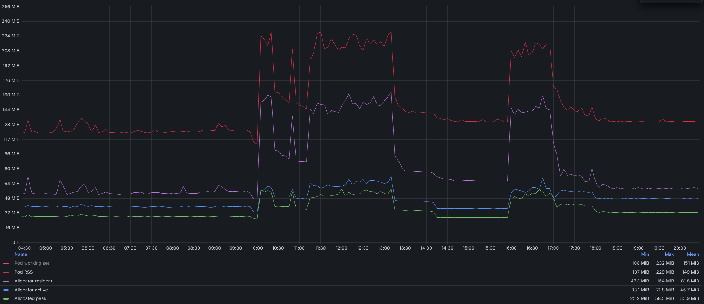

+++
title = "Memory bounded systems and backpressure in rust"
date = 2026-11-07
description = "Trest"
[taxonomies]
tags = ["memory", "rust"]
+++

As everybody knows and especially nowadays with the RAM shortage situation because of LLM's, memory is not infinite. Therefore a lot of workloads, processes, pods need system limits. For instance in the case of embedded systems but also, more usually in webservers, remote systems, and so on.
Indeed the machine hosting your process, be it virtual or physical won't have infinite RAM and once the latter is totally consumed, the kernel will start to slow or kill processes through the OOM killer, which will degrade the service you are actually trying to provide.

For this reason, it is quite usual to add limits to processes or pods in a Kubernetes context, most usually by using linux cgroups, which are a way to add CPU and memory limits on processes. Today we will only talk about memory limits, CPU limits being a whole different topic.

So what do we mean by memory backpressure? Well this is simply the ability of a system to delay new workloads or slow down to limit its memory usage to a given threshold. There are multiple solutions depending on the programming language, the kind of system you are integrating this into and the architecture of your program. We will focus on rust.

First, what can be bound and what cannot? A global process RSS holds a lot of different kinds of memories:
* The instructions of the program being run.
* The static sections, holding all of the static, mutable and non-mutable data you defined.
* Threads stacks (currently 2 MiB per stack).
* Memory allocated dynamically by the process. (TODO: talk about working set size + heap)

The only manageable one is the memory allocated dynamically. The three following solutions will concerns only this kind of memory and we will put the others in a to-measure overhead, either constant or growing linearly with the load.

The three solutions will rely on these two known example systems:

* A live ingestion HTTP server that is at the front of a data processing pipeline. We can picture this as a push based consumption model. Requests are pushed over the network, if it can't accept traffic anymore, the server will reply a `503` status code with a `Retry-After` header.
* A data processing system that will do CPU/Memory bound processing behind a stream implementation (kafka/nats). We can picture this as a pull based consumption mode. The downstream service will pull new work to perform only when it can and will rely on the stream to act as a buffer in the meantime.

We can define this difference as cooperative backpressure VS non-cooperative. Push based consumption model **expects** that the client respects the `Retry-After` header, but the client is not forced to. Pull based does not rely on an expected behavior.

# Indirect memory bounding

This solution can be applied to any language. It is not specific to rust.
The easiest way to bind your system memory is to limit two things:
* The incoming load per request. For this we need to find a metric that matches linearly with the load of the service. For example with our server implementation it could be the request body size.
* The maximum number of requests it can process in parallel with a semaphore.

If your system implements the [tower `Service` trait](https://docs.rs/tower/latest/tower/trait.Service.html) (the which I highly recommend you to do for ecosystem integration purposes), you can leverage the [concurrency limit layer](https://docs.rs/tower/latest/tower/limit/concurrency/) for this and expose the concurrency limit as a configuration knob. If your memory allocation is tied to requests handling, this might be one of the easiest solutions.

<details>
<summary>Example: bounding an axum server with tower layers</summary>

```rust
const MAX_CONCURRENT_REQUESTS: usize = 1000;
const MAX_BODY_SIZE: usize = 5 * 1024 * 1024;

#[tokio::main]
async fn main() {
    let app = Router::new().route("/ingest", post(ingest)).layer(
        ServiceBuilder::new()
            // Reply `503` + `Retry-After` when overloaded.
            .layer(HandleErrorLayer::new(|_: BoxError| async {
                (StatusCode::SERVICE_UNAVAILABLE, [(header::RETRY_AFTER, "1")])
            }))
            // Reject instead of queuing when no slot is available.
            .load_shed()
            // One semaphore shared by every route.
            .layer(GlobalConcurrencyLimitLayer::new(MAX_CONCURRENT_REQUESTS))
            // Decompress first so the limit applies to the decompressed size.
            .layer(RequestDecompressionLayer::new())
            .layer(RequestBodyLimitLayer::new(MAX_BODY_SIZE))
            // axum's own 2 MiB default limit would shadow ours.
            .layer(DefaultBodyLimit::disable()),
    );

    let listener = tokio::net::TcpListener::bind("0.0.0.0:3000").await.unwrap();
    axum::serve(listener, app).await.unwrap();
}

async fn ingest(body: Bytes) -> StatusCode {
    // At most `MAX_BODY_SIZE` bytes buffered per request.
    let _ = body;
    StatusCode::ACCEPTED
}
```

</details>

<details>
<summary>Example: a bounded NATS JetStream pull consumer</summary>

```rust
const MAX_CONCURRENT_EVENTS: usize = 8;
const MAX_EVENT_SIZE: usize = 512 * 1024;

#[tokio::main]
async fn main() -> Result<(), Box<dyn std::error::Error + Send + Sync>> {
    let js = jetstream::new(async_nats::connect("localhost:4222").await?);

    let stream = js
        .get_or_create_stream(stream::Config {
            name: "EVENTS".into(),
            subjects: vec!["events.>".into()],
            // Bound the load per event: bigger messages are rejected on publish.
            max_message_size: MAX_EVENT_SIZE as i32,
            ..Default::default()
        })
        .await?;

    let consumer = stream
        .get_or_create_consumer("processor", pull::Config {
            durable_name: Some("processor".into()),
            // Server-side bound: never more unacked events delivered to us.
            max_ack_pending: 2 * MAX_CONCURRENT_EVENTS as i64,
            ..Default::default()
        })
        .await?;

    consumer
        .stream()
        // Bound the prefetch buffer (default: 200 messages, no byte limit).
        .max_messages_per_batch(MAX_CONCURRENT_EVENTS)
        .max_bytes_per_batch(MAX_CONCURRENT_EVENTS * MAX_EVENT_SIZE)
        .messages()
        .await?
        .take_until(tokio::signal::ctrl_c())
        // The stream is not polled again until one of the events is done.
        .for_each_concurrent(MAX_CONCURRENT_EVENTS, |msg| async move {
            let Ok(msg) = msg else { return };
            process(&msg.payload).await;
            let _ = msg.ack().await;
        })
        .await;

    Ok(())
}

async fn process(_payload: &[u8]) {
    tokio::time::sleep(std::time::Duration::from_millis(50)).await;
}
```

</details>

### Capacity planning and caveats
Once you have ways to limit the workload, you need to tune them and for this you need to measure the metrics you picked against the real memory usage and define a rule.
There are multiple caveats with this solution that will appear in this process:
* you actually need to plan limits for the worst case scenario. For our server implementation, with a 5 MB request body and with a concurrency limit set to 1000 requests in parallel. You will need to reserve up to 5 GB of memory. And actually most request body might only weight 1 MB.
* Other memory allocations, allocator overhead and memory fragmentation are not counted, so you need to account manually for them, and it might scale from inputs that are completely exogenous from the requests, like the number of CPU threads, the number of blocking threads spawned by [tokio](TODO:link), the allocator used, the OS, and so on...

# Byte-budget bounding
In fact, the capacity planning complexity and caveats come from the load per request; the maximum number of parallel request itself being straightforward to plan.
So byte budget is another solution to bind the possible allocation for a given work task, through either a dedicated allocator or bounded arena. 

The idea is to limit the maximum allocated memory for the processing task either with a memory arena or a custom allocator.
One of its biggest advantage is a that it allows for a finer customization of the system behavior while we having a more precise idea of what we are limiting. And you can implement different behavior if your memory bound is reached, for example you can either flush processed data eagerly if it is a scratch bounded buffer of data or refuse any incoming data.

However it might cost you more configurations burden as the operator needs to tweak multiple limits and understand how they interact with each other. Also it might not be applicable for every systems.

Indeed, using such solutions might no be an option, especially if most of the allocations issued by your service are coming from external libs. Today, it is extremely rare to find crates that support custom allocators or that are only arena based. Some workloads can not fit the bounded arena model and the allocator trait has just [been stabilized](https://blog.rust-lang.org/2026/11/12/Rust-1.100.0/#allocator-api) (coming with rust 1.100).

# Exploring global memory bounding
A lot of memory managed langages have ways of bounding memory globally through Garbage Collection with
a best-effort mechanism. Once a given thresholds is reached, the GC starts to reclaim memory eagerly at the price of more pauses. Go has `GOMEMLIMIT`, Java has `MaxRAMPercentage` and `MaxHeapSize`, ... However there is no standard mechanism available for this in Rust (or any language that is not memory managed).

However, you can use a custom allocator that will give you stats of your heap usage. These allocators are usually declared globally (the `Allocator` trait has recently been stabilized though).

The most basic way is to make a custom wrapper to track allocated memory:

<details>
<summary>Example with a custom global allocator wrapper</summary>

```rust
use std::alloc::{GlobalAlloc, Layout, System};
use std::sync::atomic::{AtomicUsize, Ordering::Relaxed};

/// Wraps the system allocator and counts the bytes currently allocated.
struct CountingAlloc;

static ALLOCATED: AtomicUsize = AtomicUsize::new(0);

unsafe impl GlobalAlloc for CountingAlloc {
    unsafe fn alloc(&self, layout: Layout) -> *mut u8 {
        let ptr = unsafe { System.alloc(layout) };
        if !ptr.is_null() {
            ALLOCATED.fetch_add(layout.size(), Relaxed);
        }
        ptr
    }

    unsafe fn dealloc(&self, ptr: *mut u8, layout: Layout) {
        unsafe { System.dealloc(ptr, layout) };
        ALLOCATED.fetch_sub(layout.size(), Relaxed);
    }
}

#[global_allocator]
static GLOBAL: CountingAlloc = CountingAlloc;
```
</details>

However allocated memory is not the most representative metric and we can do much better!

### Using Jemallocator
jemalloc is a general-purpose allocator originally written by Jason Evans for FreeBSD’s libc, and now maintained by Meta. It is one of the most feature-complete allocators, its performance is on par with the alternatives, and its main advantage for us is that it exposes a lot of memory usage statistics, which the tikv-jemalloc-ctl crate makes it easier to read from Rust. This makes it a good fit for our use case: a HTTP server at the beginning of a data processing pipeline, ingesting and validating a high volume of data before it is processed downstream. Rust bindings and a ready to use crate are available with the [tikv-jemallocator](https://github.com/tikv/jemallocator) crate and maintained by the tikv organisation.

#### First step: collecting jemalloc metrics efficiently
Jemalloc metrics are not automatically updated, for this you need to ask jemalloc with an `epoch::advance()` call. This operation is quite costly as jemalloc has multiple arenas and will lock everything to collect each metric. Consequently this cannot be done for each request.

As the metric export interval is much higher (e.g. 30s), we also need to
track for the minimum and maximum values during the collection interval of each metrics. So we can have more insights.

First we can define a `Sample` struct to track the last value and the extremum of a jemalloc metric
during the OTEL metric export.

<details open="true">

<summary>Defining a sample struct to track the last measured value and its extremums</summary>

```rust
#[global_allocator]
static GLOBAL: tikv_jemallocator::Jemalloc = tikv_jemallocator::Jemalloc;

static ALLOCATED: Sample = Sample::new();
static ACTIVE: Sample = Sample::new();
static RESIDENT: Sample = Sample::new();
static RETAINED: Sample = Sample::new();

/// Last, min and max values of a jemalloc stat since the previous collection.
struct Sample {
    last: AtomicU64,
    min: AtomicU64,
    max: AtomicU64,
}

impl Sample {
    const fn new() -> Self {
        Self {
            last: AtomicU64::new(0),
            min: AtomicU64::new(u64::MAX),
            max: AtomicU64::new(0),
        }
    }

    fn record(&self, value: Result<usize, tikv_jemalloc_ctl::Error>) {
        if let Ok(value) = value {
            self.last.store(value as u64, Relaxed);
            self.min.fetch_min(value as u64, Relaxed);
            self.max.fetch_max(value as u64, Relaxed);
        }
    }

    /// Read an extremum and reset it for the next collection window.
    /// Falls back to the last value if no sample was recorded in the window.
    fn take(&self, extremum: &AtomicU64, empty: u64) -> u64 {
        match extremum.swap(empty, Relaxed) {
            v if v == empty => self.last.load(Relaxed),
            v => v,
        }
    }

    /// Export the `name`, `name.min` and `name.max` gauges.
    fn register(&'static self, name: &str) {
        let meter = global::meter("my-service");
        let gauge = |name: String, read: fn(&Sample) -> u64| {
            meter
                .u64_observable_gauge(name)
                .with_unit("By")
                .with_callback(move |obs| obs.observe(read(self), &[]))
                .build();
        };
        gauge(name.to_owned(), |s| s.last.load(Relaxed));
        gauge(format!("{name}.min"), |s| s.take(&s.min, u64::MAX));
        gauge(format!("{name}.max"), |s| s.take(&s.max, 0));
    }
}
```

</details>

<details open="true">
<summary>Then we can sample jemalloc metrics every second and export the results</summary>

```rust
/// Sample jemalloc every second, much more often than metrics are exported,
/// so the min/max gauges catch the peaks between two collections.
async fn sample_jemalloc() {
    let mut interval = tokio::time::interval(Duration::from_secs(1));
    loop {
        interval.tick().await;
        // jemalloc caches its stats: advance the epoch to refresh them.
        if epoch::advance().is_ok() {
            ALLOCATED.record(stats::allocated::read());
            ACTIVE.record(stats::active::read());
            RESIDENT.record(stats::resident::read());
            RETAINED.record(stats::retained::read());
        }
    }
}

#[tokio::main]
async fn main() -> Result<(), Box<dyn std::error::Error>> {
    // Push metrics over OTLP/HTTP (localhost:4318 by default, every 60s).
    let exporter = MetricExporter::builder().with_http().build()?;
    let provider = SdkMeterProvider::builder()
        .with_periodic_exporter(exporter)
        .build();
    global::set_meter_provider(provider.clone());

    ALLOCATED.register("jemalloc.allocated");
    ACTIVE.register("jemalloc.active");
    RESIDENT.register("jemalloc.resident");
    RETAINED.register("jemalloc.retained");
    tokio::spawn(sample_jemalloc());

    // ... run your service here.
    tokio::signal::ctrl_c().await?;

    provider.shutdown()?;
    Ok(())
}
```
</details>


#### Second step: measuring those metrics against a variable load to determine what are the most representative metrics.

...

#### Third step: not seeing any representative metrics and asking yourself what is wrong!
Hopefully by reading this you will not fall onto it :D! Indeed I stumbled upon two main footguns.

Firstly, the jemallocator crate defaults to prefixed symbols, so it won't override the `malloc` family set of functions in the resulting binary. If you have any C dependencies like zstd for compression/decompression, it will continue to use the default libc allocator. This is a big issue because zstd's own allocations won't be tracked by jemallocator. Hence the usage estimation will be invalid. To circumvent this, dont forget to enable the `unprefixed_malloc_on_supported_platforms` feature flag in your cargo.toml!

Secondly, the main cause of our weird memory behavior is THP or Transparent Huge Page!
Linux has a feature that might be enabled at the OS level by default named Transparent Huge Pages. This will automatically allocate bigger pages than the ones asked by your allocator and will re-address the previously-allocated smaller pages on it. The issue is that it might increase the memory usage drastically (because a small 4KiB allocation might be moved to a 1 MiB page) and more importantly, it wont be tracked as _resident_ memory by jemalloc.

Also, even with traffic being much smaller, the RSS won't reduce because most of it consists in huge pages.
The best solution is to disable this feature at the program level with a `madvise` syscall. Jemalloc will do that for you if you specify `MALLOC_CONF=thp:never` or `_RJEM_MALLOC_CONF=thp:never`. This feature can cause a lot of other unexpected issues (see the redis doc [about transparent huge page](https://redis.io/docs/latest/operate/oss_and_stack/management/optimization/latency/#latency-induced-by-transparent-huge-pages)) and it only benefits certain types of workloads, so I strongly encourage you to read about it!

Jemalloc provides a lot of metrics for you: allocated, resident, residual, retained, ... The question is not which one matches with my RSS/memory working set measured by the OS: none will. The best we can do is to measure the evolution of each metric against the RSS and determine a formula.

This being said, if we do our measure again with these two params, we can clearly see that the most representative metric is the resident, which is no suprise. Resident memory is the nearest metric from what sees the OS, because it counts allocations,
allocator overhead, fragmentations and dirty pages waiting to be removed. However, check what other metrics are available from jemalloc and whether they fit your program better! Most of the time the rule will be a linear function with a base constant to  account for the thread stacks, the program binary and static sections as well as a pre-defined scaling overhead (e.g. 75%).


With a new config being rolled out with `MALLOC_CONF=thp:never` and `unprefixed_malloc_on_supported_platforms` we can see a significant RSS drop and more importantly it now follows the same shape as the resident metric!

Now let's run a little (actually two) ingestion benchmarks to check that the resident metric follows the RSS linearly:



Here, with the two benchmarks, from 10:00 to 13:00 and from 16:00 to 17:00 we can see that resident is clearly the most appropriate metric. In comparison, the allocated metric is much smaller and barely evolving. The main reason is because the allocated memory freed is still not released by the allocator.

#### Fourth step, applying backpressure against the resident metric
<details open="true">
<summary>Backpressure against resident metric</summary>

```rust
/// Reply `503` + `Retry-After` while jemalloc holds more than `MAX_MEMORY`.
async fn memory_limiter(req: Request, next: Next) -> Response {
    if RESIDENT.last.load(Relaxed) > MAX_MEMORY {
        return (StatusCode::SERVICE_UNAVAILABLE, [(header::RETRY_AFTER, "1")]).into_response();
    }
    next.run(req).await
}

async fn ingest(body: Bytes) -> StatusCode {
    let _ = body; // validate & forward downstream...
    StatusCode::ACCEPTED
}

#[tokio::main]
async fn main() -> Result<(), Box<dyn std::error::Error>> {
    // Configure OTEL SDK and jemalloc

    let app = Router::new()
        .route("/ingest", post(ingest))
        .layer(middleware::from_fn(memory_limiter)); // add a memory limiter layer

    Ok(())
}
```
</details>

#### A small word about jemalloc metrics performances


# Conclusion
The global allocator solution is the easiest to set up, and it’s the one I usually reach for in the first place. I fall back to byte-budget bounding when it fits the target system better, or when I need fine-grained control: tuning individual components separately instead of applying a single global limit. The two aren’t mutually exclusive, and you can combine them if you need to. Whichever you choose, bear in mind the performance impact on your own workload.

Let's reclaim all the memory from LLMs!
